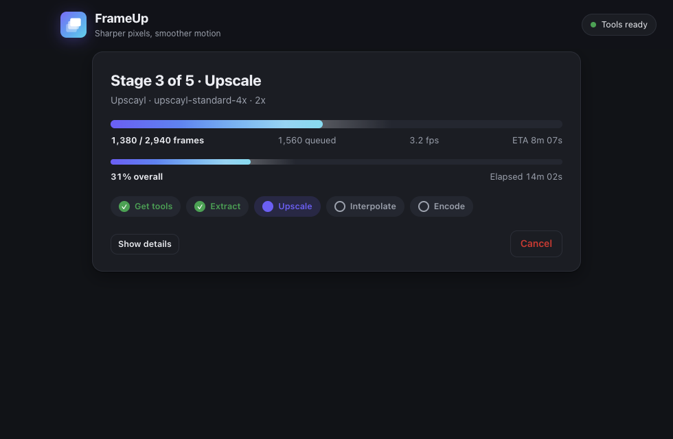

<p align="center"></p>

<h1 align="center">FrameUp</h1>
<p align="center"><b>Sharper pixels, smoother motion.</b><br>
Upscale a video with <a href="https://github.com/upscayl/upscayl">Upscayl</a>, then add silky-smooth in-between frames with
<a href="https://github.com/nihui/rife-ncnn-vulkan">RIFE</a> (or Apple's on-device ML on a Mac) — in one click, on macOS, Windows and Linux.</p>

<p align="center"> </p>

## What it does

Point it at a **video** (or a **folder of frames**) and it runs the whole pipeline for you:

1. **Extract** the frames with ffmpeg
2. **Upscale** them with Upscayl (any model you have, 2×/3×/4×) — *optional*
3. **Interpolate** extra frames to reach 60 / 120 / any fps — *optional*
   * **RIFE** (AI, runs on your GPU via Vulkan) on every platform
   * **Apple ML** (VideoToolbox frame-rate conversion, much faster, no big temp files) on macOS 15.4+
4. **Encode** a high-quality 10-bit HEVC video using your GPU's hardware encoder
   (VideoToolbox / NVENC / AMF / QuickSync), falling back to x265 / x264

A live progress view shows the current stage, `frames done / queued`, speed, ETA and overall progress. Cancelling is safe and temporary files are always cleaned up.

## Install

Grab the installer for your system from the **[Releases](../../releases)** page:

| OS | File |
|----|------|
| macOS (Apple silicon / Intel) | `FrameUp-<version>-arm64.dmg` / `-x64.dmg` |
| Windows | `FrameUp Setup <version>.exe` |
| Linux | `FrameUp-<version>.AppImage` or `.deb` |

> **Unsigned builds.** The installers are not code-signed yet.
> * **macOS:** if you see “FrameUp is damaged”, run `xattr -cr /Applications/FrameUp.app` once (or right-click → Open).
> * **Windows:** SmartScreen → *More info* → *Run anyway*.
> * **Linux:** `chmod +x FrameUp-*.AppImage`, then run it.

### The tools it needs
On first use FrameUp **downloads what it is missing** and shows the progress; nothing is bundled in the installer.

| Tool | Used for | Source |
|------|----------|--------|
| ffmpeg + ffprobe | reading / writing video | system install if found, else [eugeneware/ffmpeg-static](https://github.com/eugeneware/ffmpeg-static) |
| Upscayl | upscaling | your installed Upscayl app if found, else the [official release](https://github.com/upscayl/upscayl/releases) |
| RIFE | interpolation | [nihui/rife-ncnn-vulkan](https://github.com/nihui/rife-ncnn-vulkan/releases) (only the `rife-v4.6` model is kept) |

The **Tools** button (top right) shows what was found and lets you install things up front. Downloads live in the app's data folder.

## Requirements
* A GPU with up-to-date **Vulkan** drivers for Upscayl and RIFE (on Linux: e.g. `mesa-vulkan-drivers` or the NVIDIA driver).
* **Disk space.** Frames are written as PNG. 4K RIFE output needs roughly 30 GB per 7,000 frames; the app checks free space first and you can choose the temp folder under *Advanced*. Apple ML streams straight to the video and needs far less.
* Apple ML: macOS 15.4+ on Apple silicon.

## Command line
The same engine works headless:

```bash
npm install
node src/cli.js "My Video.mp4" --upscale upscayl-standard-4x --scale 2 --fps 60 --engine rife
node src/cli.js ./frames --src-fps 24 --fps 48            # folder of frames, interpolate only
node src/cli.js --list-models
```

## Develop
```bash
npm install
npm start          # run the app
npm test           # unit tests
npm run smoke      # downloads ffmpeg for real and checks the RIFE / Upscayl release assets
npm run dist       # build installers for the current OS into dist/
```
The code is small and dependency-light: `src/pipeline.js` (stages & progress), `src/tools.js` (find / download tools, pick an encoder), `renderer/` (UI), `native/apple/frc.swift` (Apple ML helper, compiled on macOS).
Pushing to `main` runs tests and builds installers for all three systems in GitHub Actions; pushing a `v*` tag publishes them as a release.

## Credits
FrameUp is only a friendly front-end. All the heavy lifting is done by [Upscayl](https://github.com/upscayl/upscayl) (AGPL-3.0), [RIFE](https://github.com/hzwer/ECCV2022-RIFE) via [rife-ncnn-vulkan](https://github.com/nihui/rife-ncnn-vulkan) (MIT), [ffmpeg](https://ffmpeg.org) and Apple's VideoToolbox. They are downloaded or detected at runtime and are not redistributed in this repository.

## License
[MIT](LICENSE)
